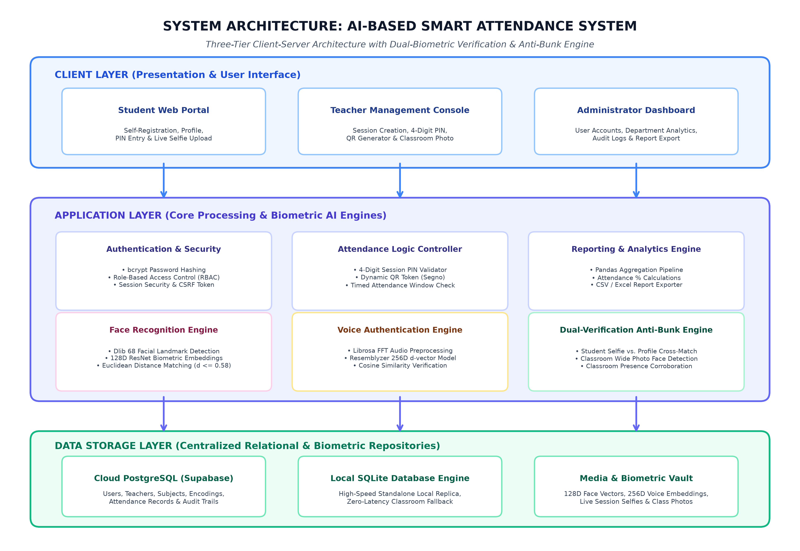
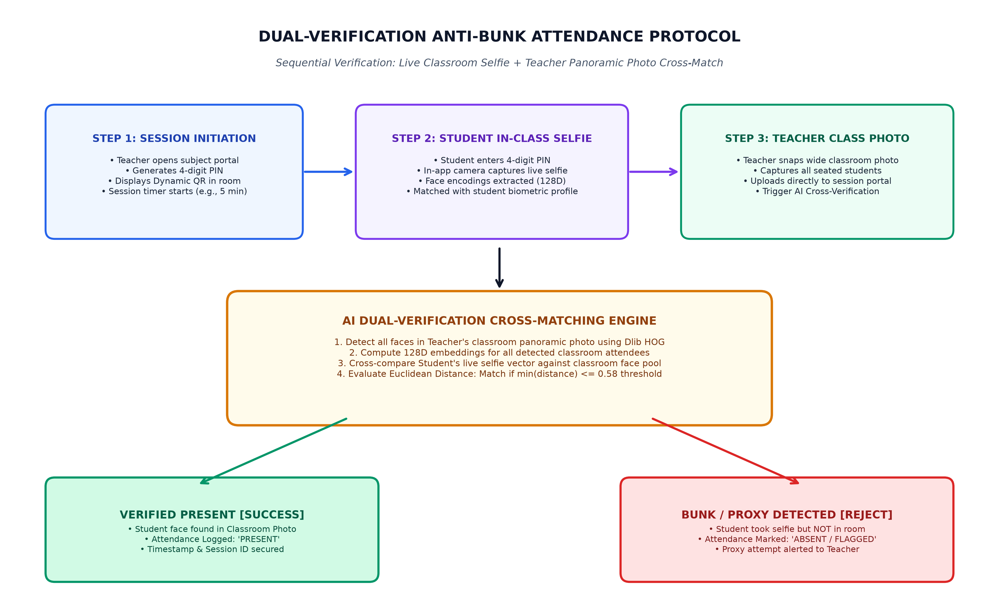
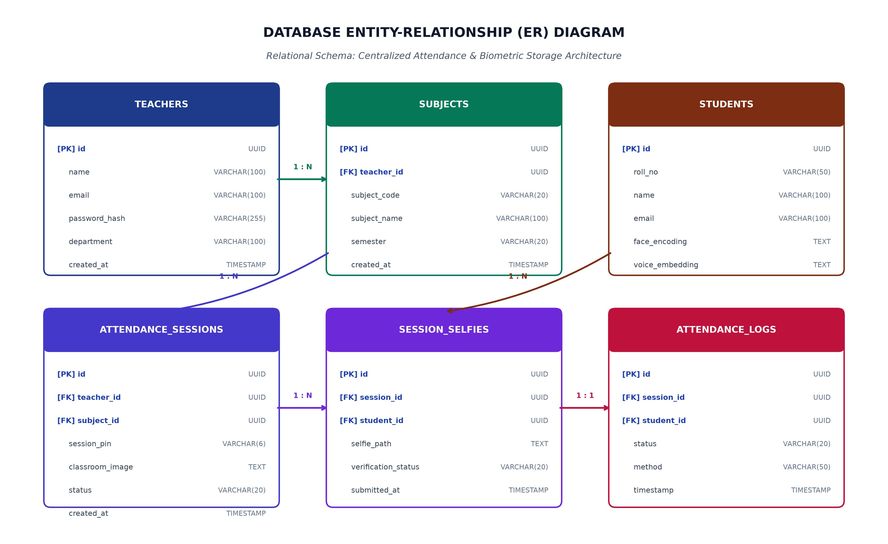
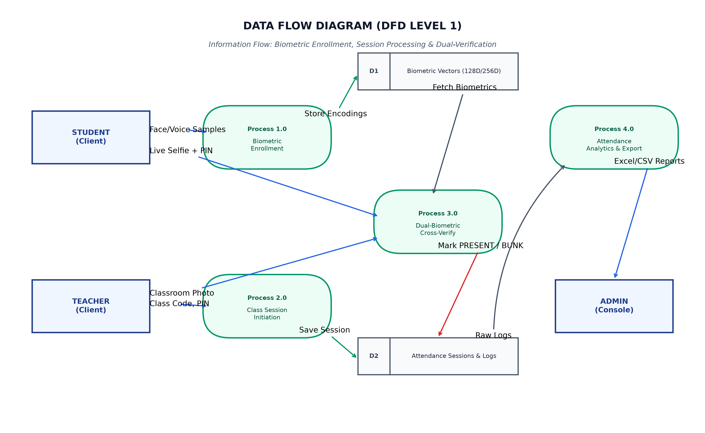

# AI-Based Smart Student Attendance System
### Dual-Biometric Verification & Anti-Bunk Classroom Presence Architecture
**Developed by Orbitals Team | ITM College of Science and Management, GIDA, Gorakhpur**  
*Affiliated to Deen Dayal Upadhyay Gorakhpur University (DDU Gorakhpur) — BCA Final Year Project*

---

## 🌟 Project Overview
The **AI-Based Smart Student Attendance System** is an enterprise-grade multi-modal biometric web application designed to eliminate manual roll-call overhead, prevent proxy marking, and mathematically eradicate **classroom bunking**.

Conventional mobile or QR attendance systems fail in colleges because absent students scan QR codes sent over WhatsApp or spoof GPS coordinates from the canteen or campus lawn. This system solves that problem using a **Dual-Verification Anti-Bunk Protocol**:
1. **Student In-Class Live Selfie:** Student inputs an ephemeral 4-digit session PIN and snaps an in-app webcam selfie, verified against their registered biometric face embedding.
2. **Teacher Classroom Panoramic Photograph:** The faculty captures a wide-angle photograph of all seated students in the lecture hall.
3. **AI Cross-Verification:** The Dlib deep metric ResNet-34 engine detects all faces in the classroom photo and cross-compares the student's live selfie vector. Attendance is marked **PRESENT** only if the student is physically detected inside the lecture room; otherwise, it is immediately flagged as **PROXY / BUNK DETECTED**.

---

## 👥 Orbitals Project Team & Supervision
- **Pratyush Mishra** (Team Leader) — Roll No: `2514018680059`
- **Atul Upadhyay** — Roll No: `2514018680041`
- **Divyanshu Upadhyay** — Roll No: `2514018680045`
- **Adesh Bhatt** — Roll No: `2514018680026`
- **Mo Ashad** — Roll No: `2514018680055`
- **Supervised by:** **Ms. Vinita Yadav** (*Assistant Professor / Project Guide, Dept. of Computer Applications*)

---

## 🏛️ System Architecture



### Three-Tier Layered Design:
1. **Client Presentation Layer:** Streamlit responsive web interface for Students, Teachers, and Administrators (Mobile & Desktop).
2. **Application & Biometric AI Processing Layer:**
   - **Face Recognition:** Dlib 68-point landmarks + ResNet-34 128D metric embeddings ($d \le 0.58$).
   - **Voice Authentication:** Librosa FFT spectrograms + Resemblyzer 256D GE2E d-vectors.
   - **Anti-Bunk Cross-Matching Engine:** Automated matrix distance comparison between student selfies and teacher room photos.
   - **Session Security:** 4-digit random session PINs + Segno dynamic QR codes + bcrypt password hashing.
   - **Reporting Engine:** Automated attendance percentage calculations and Excel/CSV export.
3. **Data Storage Layer:** Cloud Supabase PostgreSQL with zero-latency local SQLite database replication for offline resilience.

---

## 🔄 Dual-Verification Anti-Bunk Protocol



---

## 🗄️ Database Entity-Relationship (ER) Schema



---

## 📊 Data Flow Diagram (DFD Level 1)



---

## 📑 Project Reports & Deliverables Included

1. **AI Attendance System Final Project Report (.docx):**
   - `AI_Attendance_System_Project_Report_Final.docx` (Complete academic major project report formatted according to ITM College guidelines).
2. **Quantum Computing Seminar Report & Presentation:**
   - `Quantum_Computing_Seminar_Report.docx` (Complete academic seminar report covering principles, cryogenics, Shor's/Grover's algorithms, and future horizons).
   - `Quantum_Computing_Seminar_Presentation.pptx` (20-Slide widescreen presentation slide deck).
3. **Automated Document & Diagram Generators:**
   - `generate_diagrams.py` (Generates 300-DPI publication architecture diagrams).
   - `generate_report_docx.py` (Builds the complete major project report).
   - `generate_quantum_diagrams.py`, `generate_quantum_report_docx.py`, `generate_quantum_presentation_pptx.py`.

---

## 🚀 Installation & Local Setup

### 1. Clone the Repository
```bash
git clone https://github.com/pratyush866/AI-Attendance-System.git
cd AI-Attendance-System
```

### 2. Set Up Virtual Environment & Dependencies
```bash
python -m venv .venv
# On Windows
.venv\Scripts\activate
# On Linux / macOS
source .venv/bin/activate

pip install -r requirements.txt
```

### 3. Configure Environment Variables
Copy `.env.example` to `.env`:
```bash
cp .env.example .env
```
Provide your Supabase URL & Key (or the system automatically uses high-speed local SQLite fallback).

### 4. Run the Streamlit Application
```bash
streamlit run app.py
```
Open your browser at `http://localhost:8501`.

---

## 🛡️ License & Acknowledgements
- Developed for academic submission at **ITM College of Science and Management, GIDA, Gorakhpur**.
- Affiliated to **Deen Dayal Upadhyay Gorakhpur University (DDU Gorakhpur)**.
- Powered by open-source computer vision: Dlib, OpenCV, Resemblyzer, Streamlit, and Supabase.
